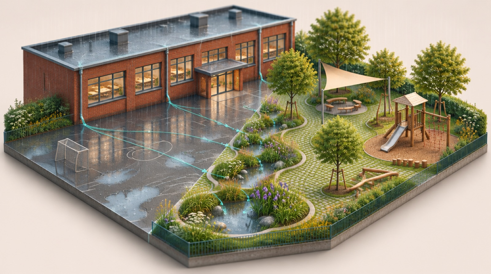

# SpongeCity AI

An interactive 3D planning tool: pick a real place, rebuild it from OpenStreetMap (and Hamburg's
official geodata), and let an AI agent redesign it with rain gardens, permeable surfaces and shade,
with measurable effect.

<p align="center">
  
</p>

**How it works:** [at a glance, in diagrams](docs/overview.md) · [architecture reference](docs/architecture.md) · [all docs](docs/README.md)

## Quick start (about 5 minutes)

### Requirements

- PHP ≥ 8.4 with `ctype`, `iconv`, `pdo_sqlite`, `zlib`
- [Composer](https://getcomposer.org) and the [Symfony CLI](https://symfony.com/download)
- No database server, no Node.js: the queue uses SQLite in `var/`, the frontend uses AssetMapper.

```bash
php -v && symfony version && symfony check:requirements
```

### 1. Install

```bash
symfony composer install   # dependencies, importmap, and the Tailwind CSS build
```

### 2. Configure `.env.local` (git-ignored)

```bash
cat > .env.local <<'EOF'
# the planning chat needs it (the 3D view and imports work without it)
ANTHROPIC_API_KEY=sk-ant-...
# Overpass and Nominatim reject generic user agents: identify yourself
OSM_USER_AGENT="SpongeCityAI-dev (you@example.com)"
EOF
```

Or keep the key in the secrets vault instead: `symfony console secrets:set ANTHROPIC_API_KEY`.

### 3. Run and check

```bash
symfony server:start -d --no-tls   # web server + workers (site import, SimStadt, agent, Tailwind --watch) + Mercure hub (Docker)
symfony console app:doctor         # checks the setup and prints how to fix what is missing
symfony open:local
```

The planning chat's replies and every change to a plan (by the agent, in the app's chat or over MCP)
reach the page through a Mercure hub (`compose.yaml`, started by the Symfony CLI through Docker):
without Docker the chat queues messages but no reply reaches the page. Only the import's progress
screen polls (every 2 s, a LiveComponent `data-poll`) until the plan is ready.

`app:doctor` checks the web server, the agent's tools (`bin/console mcp:server`), the import worker, the API key, the OSM
user agent and SimStadt. A ✘ means the app won't work; a `!` only affects an optional feature.

Any free port works. When 8000 is taken, the Symfony CLI picks another one and exports its URL,
and `DEFAULT_URI` follows it (see `.env`). Run console commands through
`symfony console`, not `php bin/console`, so they get the right URL too.

### 4. Try it

- Type a place on the home page (e.g. `Brecht-Schule Hamburg`). The import runs in the worker and
  takes 10 to 60 s; the progress page polls until the plan is ready. Places in Hamburg also get official
  buildings, street trees, terrain and infiltration data.
- Offline, without network: `symfony console app:plan:demo` creates a synthetic schoolyard and
  prints its URL.
- Your own agent: the plan page's window "Your own agent" gives the MCP server URL and the plan id.
  For Claude Code: `claude mcp add --transport http spongecity http://127.0.0.1:8000/mcp` (your
  port), then ask it to work on that plan; the 3D view follows every change it makes.

### 5. Tests

```bash
symfony php vendor/bin/phpunit
node --test 'tests/js/**/*.test.mjs'   # the browser code's pure modules (Node 21+)
```

No network, Docker or API key needed.

## Optional

| What | Needed for | How |
|---|---|---|
| Anthropic API key | The planning chat (agent). Everything else works without it. | `ANTHROPIC_API_KEY` in `.env.local` |
| **SimStadt** (Docker) | Only when someone asks the chat about the energy of the surrounding buildings (see below). | Docker Desktop running, then `docker pull --platform linux/amd64 simstadt/simstadt:cli` (about 1.3 GB, emulated on Apple Silicon). Settings: `SIMSTADT_*` in `.env`. |
| Render loop | Headless screenshots and frame-time measurements of the 3D view while working on the viewer | Node.js + Google Chrome (or `CHROME_PATH`); `bin/render-loop <plan id>` (finds the server's port itself). See [docs/render-loop.md](docs/render-loop.md). |
| Re-import a plan | After changing the importer | `symfony console app:plan:reimport <id>` |

### What SimStadt is for

[SimStadt](https://simstadt.hft-stuttgart.de/) (HFT Stuttgart) simulates how much energy
**buildings** use. The app uses it for one thing only: the **AI agent can run it when a user asks
the chat about the buildings around a site in Hamburg**. Examples: "How much heating do these
buildings need?", "How much solar power could the roofs make?", "Green roof or PV?"

- **What it computes**, for the buildings within 100 m of the site, from Hamburg's 3D building
  model:
  - `heat_demand`: yearly heating and hot-water demand per building (DIN V 18599).
  - `heat_demand_with_shadow`: the same, including shade from neighbouring buildings.
  - `pv_potential`: roof area suited to PV per roof, with kWp and yearly yield. The agent presents
    this as a trade-off against green roofs, because both would use the same roofs.
- **How it runs**: the agent's MCP tool `simulate_buildings` queues a run. The `simstadt` worker
  runs SimStadt in Docker, which takes 10 s to 2 min. The agent then collects the result with
  `get_building_simulation`.
- **What does *not* use it**: the 3D view, the site import, the rain-garden and paving design, and
  the impact numbers (runoff, permeable share, shade, temperature). Those come from the app's own
  calculation. Outside Hamburg SimStadt is never used.
- **Without Docker or the image**: everything works except these building questions. The run
  fails, the error is logged, and the agent gets that error back instead of results.

(The docs also say buildings are classified "the way SimStadt does". That only describes the
building-type scheme. That code doesn't call SimStadt and doesn't need it.)

## Good to know

- Plans and the SQLite database with the Messenger queues live under `var/share/<env>/` locally (in production, plans live in Redis: `STORAGE_REDIS_URL`): `cache:clear` keeps them, deleting `var/share` resets them. Deploying: [docs/deployment.md](docs/deployment.md).
- Logs: `symfony server:log`, or `var/log/dev.log`. The Messenger workers restart on changes to
  `config/`, `src/`, `lib/` and `vendor/`; the Tailwind worker rebuilds the CSS whenever a template
  or stylesheet changes.
- `app:plan:demo` and `app:plan:reimport` print the plan as a full URL you can click.
- Public Overpass mirrors are sometimes overloaded; the import tries several and caches results
  for a day. A failed import shows on the plan page with a way back.
- Stop everything: `symfony server:stop`.
