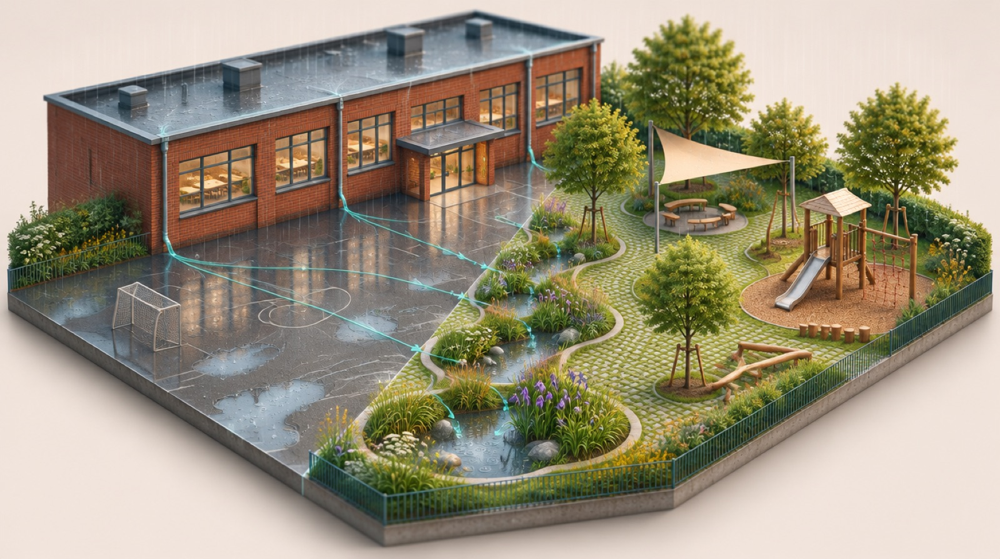
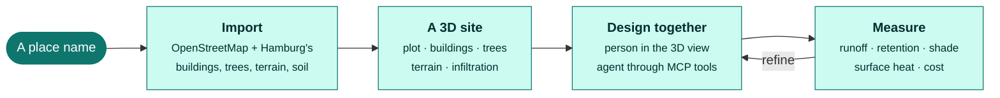

# SpongeCity AI documentation

  

SpongeCity AI turns a real place into a 3D site from open and official geodata, and lets a person
and an AI agent redesign it together with rain gardens, permeable surfaces and shade. Every change
is measured, and every number says where it comes from.

## Start here

| If you want to… | Read |
|---|---|
| Run it on your machine in about five minutes | [README](../README.md) |
| Understand the system in a quarter of an hour, through diagrams | [**At a glance**](overview.md) |
| Look up how a part works and why it was built that way | [Architecture reference](architecture.md) |
| Iterate on the 3D view with screenshots and frame times | [Render loop](render-loop.md) |
| Understand how Hamburg's roofs are fitted and drawn | [Roof geometry](roof-geometry.md) |

## The system on one page

## What is in the overview

1. **System context:** the app, its two workers, and the services it talks to
2. **Inside the application:** entry points, services, engine and stores as layers
3. **Starting a plan:** from the home form to a site that is ready
4. **The import pipeline:** six tagged steps, each replaceable
5. **Lifecycles:** the `PlanImport` and `SimulationRun` state machines
6. **One chat turn:** how the agent designs through this app's own MCP server
7. **Placing an intervention:** the agent chooses, the server does geometry and rules
8. **Where state lives:** every store, its key and who reads it
9. **From values to pixels:** the configurator engine

## Writing docs here

- **Diagrams are Mermaid** in the Markdown, so they are reviewed and diffed like code. GitHub and
  most editors render them. Reuse the colour classes from [overview.md](overview.md): teal for
  entry points and people, blue for services, violet for the engine, amber for data.
- **Name the class or file.** A reader should be able to jump from a sentence to the code.
- **Numbers come with their source**, in the docs as in the app.
- **Illustrations** in `images/` are concept art. They show ideas, never screens or data, and
  carry no text that could go stale.
