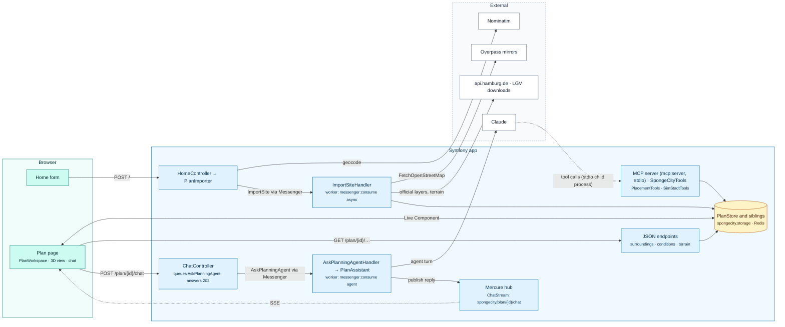
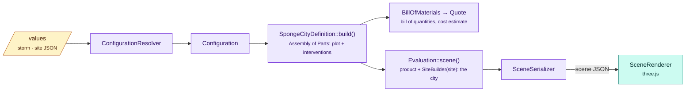
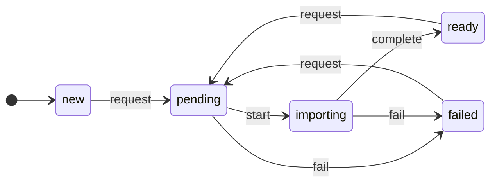
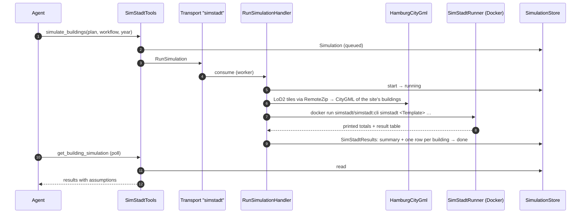

# SpongeCity AI: architecture

An interactive 3D planning tool: pick a real place, rebuild it from OpenStreetMap, and let an AI
agent redesign it with rain gardens, permeable surfaces and shade, with measurable effect.

Stack: Symfony 8.2 (beta), Symfony AI 1.0 (beta: `ai-bundle`, `ai-agent`, `ai-anthropic-platform`,
`ai-mcp-tool`), `mcp-bundle` / `mcp/sdk` (PHP MCP SDK), Messenger, UX Live/Twig Components,
Stimulus, Tailwind v4, three.js. The 3D engine and UI kit come from the `sf_configurator` project.

## Big picture

> A visual tour with nine diagrams is in [overview.md](overview.md). This page is the reference.



Everything is addressed by a **plan id**. The browser and the agent's MCP tools run in separate
requests and share state only through `PlanStore`.

## Layers and directories

| Path | What lives there |
|---|---|
| `lib/Core/Configurator/` | The parametric 3D engine, copied from `sf_configurator` (namespace `Core\`). Framework-light, no Doctrine. |
| `lib/Core/Configurator/Product/SpongeCity/` | The product definition, SKUs, intervention builder and the impact calculation. |
| `src/SpongeCity/` | Application services: plans, geodata, import, chat. |
| `src/SpongeCity/Geo/Hamburg/` | Hamburg's official geodata (OGC API Features at api.hamburg.de): buildings, street trees, infiltration potential. |
| `src/SpongeCity/Conditions/` | What official data says about a site's ground (`SiteConditions`: infiltration potential, sources). |
| `src/SpongeCity/Terrain/` | The ground of a plan (`Terrain`, `TerrainGrid`), standing objects on it (`SiteGrounding`), reading it for the agent (`TerrainAnalysis`). |
| `src/Mcp/` | The MCP tools (`SpongeCityTools`). The MCP registry is restricted to `App\Mcp\`. |
| `src/Controller/`, `src/Twig/` | HTTP entry points, the `PlanWorkspace` Live Component, Twig functions for the viewer. |
| `assets/configurator/` | three.js scene renderer, environments, textures, models (from `sf_configurator`), the city around an aerial site (`real_city.js`, `city_blocks.js`). |
| `assets/controllers/` | Stimulus controllers: `configurator_viewer`, `plan_chat`, UI kit controllers. |
| `templates/components/` | The shadcn UX Toolkit components (`<twig:Button>` …) and `PlanWorkspace`. |
| `config/prompts/spongecity.md` | The agent's system prompt. |
| `tools/render-loop/`, `bin/render-loop` | Headless Chrome render loop for the 3D view: screenshots, flicker and frame-time measurements (see "Render loop"). |

## The configurator engine

Data flow (see `sf_configurator/docs/configurator.md` for the full framework):



Units: **millimetres** on the server, metres in the browser. Plan coordinates: **x east, z south**,
origin = the searched point.

### The site

The city and the design are one structured parameter, `site`: `{"objects": [{id, type, …fields}]}`,
normalised by `Site\SiteType` (defaults filled in, numbers clamped, unknown things dropped, max 200
objects, coordinates within `SiteObject::REACH` = 100 m of the centre), so nothing an agent sends
can break the scene. Types are specified once in
`Site\SiteObject::fields()`; the JSON Schema for agents is derived from it.

| Kind | Types | Built by | Meaning |
|---|---|---|---|
| Context (real) | `plot`, `building`, `road`, `tree`, `house`, `paving`, … | `SiteBuilder` (scenery, no SKU) | What exists today (imported from OSM). |
| Interventions | `newtree`, `raingarden`, `permeable`, `planting`, `shadesail` | `InterventionBuilder` (parts **with SKU**) | What the agent plans. |

Because interventions have SKUs they are *the product*: they are priced, listed in the bill of
quantities, framed by the camera and named on hover. The `plot` is built with SKU `SC-PLOT` but
`counted: false`, so the camera frames the whole yard without it appearing on the bill.

A `building` carries its `height`, `use` (`Site\BuildingType`), `facade` (`Site\Facade`), `color`,
`roof` and `roofColor`; a `road` is a centre line with `width` and `kind` (carriageway or footway).
`SiteBuilder` draws a footprint as walls with the façade's window texture plus a roof slab (gravel
when flat, tiles when pitched); a near-rectangular footprint with a pitched roof gets a real gable or
hip roof over its minimum-area rectangle (`Site\PitchedRoof`, at the building's `pitch` when known), and
a building with its own `model` (Hamburg) gets the model's roof surfaces and gables
([roof-geometry.md](roof-geometry.md)). Roads are thin strips (carriageways 7 mm, footways 10 mm
above ground, the plot 4 mm: see "Depth and flicker").

`InterventionBuilder` sets the environment hints `Environment::AERIAL` (the viewer looks down on the
site: bird's-eye camera, larger max distance, a city instead of a garden around it) and
`Environment::SUBURBAN` when the site's buildings are mostly low (median ≤ 10 m or ≥ 40 % houses),
so the generic city around it is a suburb rather than perimeter blocks.

### Impact calculation (`Impact\ImpactCalculator`)

Compares the plan **without** interventions (baseline) to the plan **with** them:

- The plot is rasterised into square cells (≤ 40 000 cells); each cell takes the top-most surface,
  so overlaps resolve like in the 3D view and nothing is counted twice.
- Surfaces are `Impact\GroundClass` values with a runoff coefficient (typical DWA-A 138 /
  DIN 1986-100 values) and an indicative midday surface temperature of a hot north German day
  (dark asphalt 55 °C, lawn 31 °C, the air 30 °C).
- **Ground nobody described is `GroundClass::Unknown`**, not asphalt: the import gives the plot the
  surface `unknown` (the map shows its outline, not its surface), so open ground outside every known
  area is unknown. Each of its numbers lies halfway between `UNKNOWN_BOUNDS` (asphalt and lawn): half
  sealed (for the rain gardens' catchment, `sealedShare()`), not counted as permeable, 43 °C in the
  sun. The report warns how far the surface temperature could go (all asphalt, all lawn) and tells the
  agent to ask and `describe_zone`. Plans imported before keep their asphalt plot until re-imported
  (`app:plan:reimport`).
- **Shade cools a surface by what it is warmer than the air** (`surfaceTemperatureIn()`): in the
  shade `SHADED_EXCESS_SHARE` (a quarter) of that remains, never warmer than in the sun. Shaded
  asphalt is about 19 K cooler (US EPA: 11 to 25 K), shaded lawn about 1 K: a tree over asphalt
  cools the ground far more than one over a lawn.
- Rain gardens capture runoff from the sealed area around them, up to their storage and a 10:1
  catchment ratio (otherwise a warning is reported). Tree crowns intercept 2 mm.
- Shade is a ray march toward the sun (14:00, mid-summer: 52° elevation, from the south-west)
  against buildings, tree crowns and shade sails.
- Result: `ImpactReport` of `Metric`s (permeable share, runoff volume, retained volume, runoff
  coefficient, shade share, surface temperature), each with baseline, design, delta and its
  **basis**, plus the list of assumptions and warnings. Every number is traceable; the UI shows the
  bases under "Calculations and assumptions".

This is a planning-level estimate, not a simulation. Keep new rules in `GroundClass` /
`ImpactCalculator` and list them in the report's assumptions.

## Plans and state

`App\SpongeCity\Plan\Plan` is an entity: id, title, location, configuration `values` (`storm`,
`site`, changed through `replaceSite()` and `setStorm()`) and a `PlanStatus`, which only the
`PlanImport` state machine moves (below). `PlanStore` keeps plans in
the storage pool `spongecity.storage` (Redis in production, so it outlives deploys; on a developer machine an alias of `cache.app` under `var/share`), with no database entities. This is deliberate for the demo:
the browser and the MCP tools read and write the same plan in separate requests.
`SiteEditor` is the only code that mutates the site (add, update, remove, clear interventions); it
always goes through `SiteType::normalize()`.

`PlanAnalyzer` combines `PlanEvaluator` (engine) and `ImpactCalculator` into impact and cost. The
running costs are a second price list (`SpongeCityDefinition::maintenancePrices()`, cents per unit
and year) priced against the same bill of quantities, so investment and care always cover the same
measures; the lifecycle total adds `LIFECYCLE_YEARS` of them, undiscounted.

Funding (`Funding\FundingEstimate`) applies the programmes of the plan's place (`HamburgFunding` for
plans in Hamburg, none elsewhere) to the same quote: each programme pays its share of its SKUs' lines
for the plan's `Applicant` (a plan value, set in the cost panel or with `set_funding_applicant`),
capped (per building for green roofs) and only above its minimum size. An unknown applicant gets each
programme's highest share, labelled "up to"; public owners get nothing from these programmes. The
programmes carry their guideline's URL and date: the terms change, the estimate says so.

`ValueForMoney` weighs the measures against each other: a measure's effect is the plan's balance
minus the balance without it (leave-one-out, so overlaps such as rain gardens sharing a catchment
count once for the plan as it is), divided by its own investment (`PlanAnalyzer::measureCosts`,
the measure priced alone) and lifecycle cost. `PlanAnalyzer::impactOf()` caches any site's balance
by its JSON and storm, so the variants and scenarios cost one raster each, once.

### The import as a state machine (`PlanImport`)

A Symfony Workflow state machine, defined in its class (`#[AsWorkflow]`, a `#[Transition]` per
constant, the places from the `PlanStatus` enum; `symfony console workflow:dump plan_import`):



- `PlanImporter::request()` is the one way in (home page, `load_site`, `app:plan:reimport`): a new,
  ready or failed plan is requested and queued; one that is pending or importing is left alone
  (`load_site` says so). Pending always means a message is queued.
- The worker applies `start` (a second worker for the same plan finds it importing and stops),
  then `complete` with the new site, or `fail`.
- Both `request` and `start` read the plan again and apply the transition under a per-plan lock
  (`symfony/lock`, `PlanImport::LOCK_PREFIX`): the cache store has no compare-and-set, so without
  it two requests could queue a plan twice, or two workers both start it. The lock is released
  before dispatching, since a sync dispatch (the console) runs the worker in the same process.
- `PlanImport::store()` (`#[AsEnteredListener]`) saves the plan in every status it enters: the
  page and the agent poll it. `ImportSurroundings` (`#[AsCompletedListener]` on `complete`)
  imports the surroundings once the site is in place.

SimStadt runs have their own state machine, `SimulationRun` (`queued → running → done | failed`),
built the same way. Its worker takes a run up under a lock as well, and ignores a repeated or stale
message for a run that is no longer queued.

Plans are not persisted beyond the cache. For production, replace `PlanStore` with a database
backed implementation (the interface is small: `create`, `find`, `get`, `save`).

`PlanStore`, `SimulationStore`, `TerrainStore`, `SurroundingsStore` and `SiteConditionsStore`
extend `CacheStore` (one kind of object per key in `spongecity.storage`). In production the cache
`prefix_seed` is pinned: the namespaces would otherwise follow the release directory. Controllers take the plan as an
argument (`Plan $plan`): `PlanValueResolver` looks up the route's `{id}` and answers 404 when
there is none. The chat binds its message with `#[MapRequestPayload]` to `ChatMessage`
(validated: not blank, at most 2000 characters).

## Geodata and the import (async)

1. `HomeController::start()` binds the form to `PlaceSearch` (`#[MapRequestPayload]`) and calls
   `PlanImporter::start()`: it geocodes the text with `NominatimGeocoder` (synchronous, fast),
   takes the first hit, creates a `new` plan and dispatches `ImportSite`. The controller
   redirects at once (back home with a flash message when nothing was found).
2. `ImportSiteHandler` (Messenger worker) runs every `SiteImportStep` (a tagged interface,
   `#[AutowireIterator]`, ordered by `#[AsTaggedItem(priority)]`), handing a `SiteImportContext`
   from one to the next. `FetchOpenStreetMap` asks `OverpassClient` for the area:
   - the ways the point lies in (`is_in` + `pivot`): leisure (playground, pitch, garden, park,
     schoolyard), amenity (school, kindergarten, …), landuse (education, residential). Not
     `around:1`: that measures the distance to a way's *outline*, so a point well inside a school
     yard was never "around" its polygon and every plan fell back to the square;
   - buildings, streets (`highway=*`) and `natural=tree` nodes within the radius (80 m, 30 to 150 m
     via the MCP tool).
3. `BuildSite`: `SiteImporter` projects lat/lon to plan millimetres (`LocalProjection`) and builds the site
   JSON: the **plot** is the most specific polygon containing the point (leisure > amenity >
   landuse, smaller wins), else a 40 m square; buildings (nearest first, at most 80) cut to the
   reach with Sutherland-Hodgman rather than squashed by the clamp; streets as `road` objects cut
   where they leave the reach (at most 40); at most 30 trees.
4. `BuildingTags` classifies each building the way urban energy simulation does (SimStadt: building
   function + IWU/TABULA archetypes such as detached house, terrace, apartment block, high-rise):
   `building=*` and the storeys give a `BuildingType`, which suggests a `Facade` (plaster, brick,
   window bands, cladding) and a roof; `building:material`, `building:colour`, `roof:shape` and
   `roof:colour` from the map win. Missing colours are picked from the façade's palette, seeded by
   the building's position, so a re-import looks the same. Heights from `height`, else
   `building:levels` × 3 m, else 9 m.
5. Before that, `ApplyOfficialLayers` has `MapLayers` apply every `MapLayer` (a tagged
   interface) that covers the area: in Hamburg, the city's own buildings and street trees replace
   OpenStreetMap's (below, "Hamburg's official geodata"). A layer whose service fails is skipped,
   and that kind of element stays as OpenStreetMap has it.
6. `ImportTerrain` and `CollectSiteConditions` store the ground and what official data says
   about it, with the sources of every layer; `GroundSite` puts the objects onto the terrain.
7. The handler completes the import with the new site (or fails it when a step throws); the
   **surroundings** (below) follow on `complete`. A failure there never fails the plan.

### Hamburg's official geodata

Inside Hamburg (a bounding box, `Hamburg::covers`) three layers come from the city's
OGC API Features (`HamburgApi`, `https://api.hamburg.de/datasets/v1`, GeoJSON or CityJSON per
bounding box, paged, cached a day per box: `CACHE_VERSION` in the key):

| Layer | Datasets | Becomes |
|---|---|---|
| Buildings (`HamburgBuildingLayer`) | ALKIS `alkis_vereinfacht/GebaeudeBauwerk` (footprint, function, storeys) joined with LoD2 `lod2_hamburg/building` (measured height, roof form, eaves) by ALKIS id (LoD2 id + `BL`) | `building` objects of the site and the surroundings |
| Street trees (`HamburgTreeLayer`, the site only) | Straßenbaumkataster `strassenbaumkataster/strassenbaumkataster_hh` (species, planting year, crown diameter), heights from the 3D Straßenbaumkataster (laser scan) | `tree` objects with `diameter` (crown), measured `height` and a label ("Spitz-Ahorn, 1982") |
| Infiltration (`HamburgInfiltration`) | Versickerungspotentialkarte `versickerung/versickerungspotential` | `SiteConditions` (areas with holes, cut to 100 m around the site) |

- The Hamburg layers are turned into **Overpass-like elements with OpenStreetMap tags**
  (`building=school`, `height`, `building:levels`, `roof:shape`, `diameter_crown`, …), so
  `SiteImporter`, `SurroundingsImporter` and `BuildingTags` stay unaware of the source.
  ALKIS functions map to `building=*` by keyword (`HamburgBuildings::FUNCTIONS`), the LoD2
  roof codes (ALKIS Dachform) to `roof:shape`; Bauteile and buildings below ground are left out.
- **Roof levels**: a flat-roofed building whose roof has several levels (a low wing, the main
  roof, a recessed top storey, a stair core) carries them as `parts` (`SiteObject::PARTS`:
  `{points, height}` per roof surface, at most 40), drawn as a block each and casting their own
  shade in the impact calculation. As one block at the measured height (the highest point) a
  two-storey wing stood as tall as the tower beside it. The cadastre's storeys belong to the
  largest part (the window rows follow it).
  - On the site, from **LoD3.0-HH** (`HamburgLod3`, LGV, dl-de/by-2-0): the roofscape modelled by
    hand from 2020 aerial photos, with recessed storeys and roof structures from 1 m². Five area
    ZIPs of 1 km CityGML tiles named by the last two digits of the UTM kilometre (`6734.gml`); a
    tile may be split over two areas. Tiles are 10–60 MB unpacked, so they are **streamed**
    (`RemoteZip::stream`: range request unbuffered, inflated piece by piece, each building parsed
    as soon as it is complete, `CityGmlRoofs::streamed`) and only the result per site is cached.
    Its ids are mostly the cadastre's; where they are not (area 4), buildings are matched by
    position. The Brecht-Schule: 14 levels (main roof 20.8 m, recessed top storey 23.7–24.5 m,
    stepped wing 5.5–7.1 m) where LoD2 had 3.
  - Elsewhere (the surroundings), from LoD2's full-precision CityGML (`HamburgCityGml`).
  - Pitched roofs keep their gable or hip; parts only for roofs at least 80 % flat.
- **Pitched roofs** (site only) are fitted to LoD2's roof surfaces (`RoofFit`): a plain gable or
  hip within 0.4 m (root mean square, at most 1 m anywhere) is drawn parametrically at the
  model's pitch; anything else (an L or U, half-hips, towers, a mix) as the model's own roof
  surfaces and its walls above the eaves (`model`). See [roof-geometry.md](roof-geometry.md).
- **Long outlines** (more than 36 corners) lose their least significant corners first
  (Visvalingam–Whyatt), not every n-th one, so walls stay where they are.
- **Storeys**: buildings keep the cadastre's storeys (`storeys`); the façade texture is stretched
  upwards so each row of windows is one storey (`Facade::textureHeight`, 2.6 to 6 m). From three
  storeys on, the ground floor is a quarter taller than the rest (3.5 to 5.5 m): the walls are two
  stacked pieces, each with its own rows (`SiteBuilder::facadeWalls`). Before, every
  façade had 3 m rows, and a school with 4–5 m floors looked twice as many storeys high.
- **Looks are a guess**: no dataset records façade material, so it is picked from the use
  (`BuildingType::facades`; `render` is the newer rendered wall with tall, dark-framed windows).
  A user who knows better tells the agent, which corrects `facade` and `color` with
  `update_object` (`get_site` lists building ids). Such a building's `look` becomes `user`, and
  `app:plan:reimport` gives it back to the building standing in the same place.
- **Glazed bands**: roof parts under a metre wide that rise above the main roof are wall tops the
  model draws for a glazed top storey or a glass railing: rendered wall up to the main roof, glass
  above it.
- A pitched roof stands on its eaves: the eaves height is the lowest roof point over the lowest
  ground point of the LoD2 solid (on the site from the full-precision CityGML, see `RoofFit`). The API quantises LoD2 vertices to whole metres, which is why
  footprints come from ALKIS, not from LoD2.
- The register knows **street trees only**: OpenStreetMap trees more than 3 m from a registered
  one (yards, parks) stay. A recorded crown is used by the impact calculation instead of the
  28 %-of-height estimate.
- **Tree heights** come from the "3D Straßenbaumkataster Hamburg" (LGV, dl-de/by-2-0, metadata
  `24513F73-D928-450C-A334-E30037945729`): the highest point of the airborne laser scan (April
  2022) within the crown above the DGM1 ground, joined by tree number (`Baumnummer`). It is read
  per site from the layer's 3D Tiles (`Hamburg3dTiles`: the tileset walked down to the leaf tiles
  touching the site, external tilesets followed, batch tables of i3dm/b3dm/composite tiles read;
  no geometry decoded). The same data exists as one 487 MB CityGML file, which cannot be read in
  pieces. Trees the scan could not measure, or all of them when the layer is unavailable, get the
  estimate 1.3 × crown + 2 m; `height:source` says which. On the Brecht-Schule the estimate was off
  by up to 6.6 m (old limes 20.8 m measured against 15 m estimated).
- Not used: "Grünes Hamburg in 3D" (CC0, all other vegetation from the laser scan, no species): its
  metadata limits it to visualisation and rules out shade, crown areas and counts. "3D Stadtbäume"
  in the 3D portal has no metadata or licence.
- **Each layer falls back on its own**: when a service fails, that layer stays as OpenStreetMap
  has it (logged as a warning); outside Hamburg nothing is asked.
- Every layer used is a `DataSource` (title, publisher, as of, licence, URL, limitations), kept in
  the plan's `SiteConditions`. The page shows the attribution under the view (Datenlizenz
  Deutschland – Namensnennung 2.0, as the licence requires); `get_site_conditions` gives them to
  the agent.
- Infiltration classes (`Conditions\InfiltrationPotential`), best first: possible (> 5 m to
  groundwater, any facility), likely (2 to 5 m), limited (1 to 2 m), unlikely (< 1 m). A
  preliminary assessment, never an infiltration rate; the agent is told to say so.

Not imported yet: surface sealing (the Bodenversiegelung WFS and OGC API answered 404 in
November 2026), runoff paths and the heavy-rain hazard map.

### Terrain (DGM1)

Hamburg publishes its 1 m terrain model (bare earth, airborne laser scan 2022) only as one
1.4 GB ZIP of 926 GeoTIFF tiles (1 × 1 km, float32, LZW). `HamburgElevation` reads it with
**HTTP range requests**: the end of the ZIP for its central directory, then the local header
and the deflated bytes of each tile it needs (about 1.7 MB); both are cached for a week.
`ElevationTile` reads the GeoTIFF itself (one strip, LZW or none, float32, tie point and pixel
scale; no GDAL). `Utm` projects ETRS89 to UTM 32 (Krüger series; matches PROJ to 0.1 mm).

`HamburgTerrain::around()` samples two grids around the origin, each node the mean of the 1 m
heights in its cell: **2 m out to ±120 m** (the site and the lawn) and **4 m out to ±360 m** (the
real surroundings), in centimetres relative to the origin's height (`Terrain::reference`, m
above sea level). Between 300 and 350 m the heights fade to 0, so the generic city beyond stays
flat. Building them takes about 2 s (under a second with cached tiles), at most 4 tiles.

Who uses it:

- **Upright objects** (`SiteObject::UPRIGHT`: buildings, trees, walls, sails, …) get a
  `ground` field (mm): the lowest ground along their outline, sampled every metre.
  `SiteGrounding` sets it whenever a site is saved (import and `SiteEditor`), so whatever the
  agent adds stands right; `ground` is not in the agent's schema. `SiteBuilder` and
  `InterventionBuilder` raise every part of such an object by it (`Part::raisedBy`).
- **Ground layers** (plot, roads, paving, rain gardens, permeable surfaces, planting) are parts
  with `draped: true`; the view lays them over the terrain.
- **The 3D view** (`terrain.js`, `TerrainField`, from `GET /plan/{id}/terrain`; 204 without
  terrain) is loaded before the surroundings and the overlay. Within a grid the ground is
  **linear on the two triangles of each cell** (split north-west to south-east), in PHP
  (`TerrainGrid::heightAt`) and JS alike. The lawn is built on exactly those triangles, and a
  draped part is cut along the grid lines and diagonals so each piece lies in one triangle: lawn,
  plot, roads and surfaces then stay parallel at their millimetre offsets on any slope (with
  plain subdivision they drifted by centimetres and the lawn showed through the plot). The real
  city's buildings stand on the lowest ground under them, its streets are subdivided to 4 m,
  its trees, the generic blocks and the city ground follow `heightAt` too. The infiltration
  overlay is draped like a ground layer.
- **The agent**: `get_site_conditions` adds `terrain` (`TerrainAnalysis`, on the plot's open
  ground, buildings left out): elevation range, relief, mean slope, the direction surface water
  runs, and up to five low spots (lower than the ring 8 m around them by ≥ 5 cm). Hollows deeper
  than 1 m are marked "probably built": on the Brecht-Schule plot the deepest is the 3 m ramp to
  the underground car park, which the model shows like any other ground.

### Surroundings (the real city around the site)

`SurroundingsLoader` imports the OSM buildings and streets out to 350 m
(`ImportSite::SURROUNDINGS_RADIUS_METRES`) through `OverpassClient::surroundings()` and
`SurroundingsImporter` (same `BuildingTags`; buildings that are the site's own are left out), and
keeps them in `SurroundingsStore` (cache pool, next to the plan). They are context for the 3D view
only: not part of the site, the agent's tools or the balance. `GET /plan/{id}/surroundings`
(`SurroundingsController`) returns them as JSON in metres; a plan that has none yet (older plans)
imports them on that first request. The viewer fetches them once in the background.

`symfony console app:plan:reimport <id>` rebuilds a plan's site and surroundings at once (no
worker), keeping its interventions: useful after importer changes.

The plan page polls (`data-poll`) while pending or importing and shows a clear failed state with a way back.

`OverpassClient` tries several public mirrors in order (`overpass.openstreetmap.fr` first), skips
a silent one after 30 s (under load they take 20 s even for small queries), and caches results per place and radius for a day (`CACHE_VERSION` in the
key: bump it when a query changes). Public Overpass
instances are shared and often overloaded, and they reject generic user agents: set
`OSM_USER_AGENT` to something identifying you (also required by Nominatim's usage policy).
It is sent with every outgoing request (`framework.http_client.default_options` in
`config/packages/framework.yaml`), so the clients do not set it themselves.

Messenger: transports on Doctrine (SQLite under the share dir), no retries, failed messages go to the
`failed` transport. `async` imports sites (the mirrors are the retry), `simstadt` runs building
simulations, `agent` runs the planning agent's turns (a failed turn may already have changed the
plan, so the person asks again). **A worker must run for each** (`messenger:consume async`,
`simstadt`, `agent`); `.symfony.local.yaml` starts them with `symfony server:start`. DBAL is
installed only for the queues.

## The agent and MCP

`config/packages/ai.yaml` defines the agent `spongecity` (Anthropic, `claude-sonnet-5-5`, prompt in
`config/prompts/spongecity.md`). The model name carries `?max_tokens=8000`: the limit covers the
model's thinking *and* its answer, and with the platform's default of 1000 the thinking could use it
all up, so the reply came back as a bare `ThinkingResult` and `asText()` failed ("The planning
agent could not answer"). Its tools are the **MCP server of this same application**:

- **Server** (`mcp-bundle`, `config/packages/mcp.yaml`): serves the `#[McpTool]` methods of
  `App\Mcp\*` over two transports. **stdio** (`bin/console mcp:server`) is how the agent reaches it;
  **HTTP** (`/mcp`, `McpEndpoint`) is for an agent a person connects themselves: Claude Desktop,
  Claude Code, any MCP client, or the inspector. The plan page's window "Your own agent" gives the
  URL, the plan id and the `claude mcp add` command. It is open like the plan page (the plan's id is
  the key); the DNS rebinding protection accepts the app's own host (`DEFAULT_URI`) and localhost,
  any other Host header gets a 403. Outside agents read the server's `instructions` (`mcp.yaml`)
  instead of the in-app agent's system prompt. Sessions live in `cache.app` (`store: cache`, with a
  lock), so every PHP-FPM process and the next release know them.
- **Rate limits** (`McpRateLimits`, `config/packages/rate_limiter.yaml`), per client address and only
  over HTTP (the in-app agent is not limited): every request to `/mcp` (429 with `Retry-After`
  beyond it), and more tightly the expensive tools, `load_site` and `search_place` (the public map
  services) and `simulate_buildings` (Docker): beyond their share they answer with a tool error
  the agent reads.
- **Every change reaches the page** (`PublishPlanChanges`, a listener on the SDK's `ResponseEvent`):
  after a successful call of a tool that is not marked read-only (its `#[McpTool]` annotations) and
  takes a `planId`, `PlanUpdates` publishes on the plan's Mercure topic `spongecity/plan/{id}`, and
  every page showing the plan re-renders (`plan_updates_controller.js`, a burst of calls gathered
  into one render). One listener, for both transports: the in-app agent's stdio child and an
  outside agent over HTTP.
- **Client**: `mcp.clients.spongecity.servers.local` starts `bin/console mcp:server` as a child
  process (`transport: stdio`) for the chat turn, in the `agent` worker, with the parent's environment plus its
  `APP_ENV`/`APP_DEBUG`, so it reads the same storage (the same plans). No URL, no network, no
  host check. The agent's `tools: - mcp_server: 'spongecity.local'` exposes the tools to the model
  with the prefix `local_`. Both are built-in symfony/ai and mcp-bundle wiring: the tools are
  declared once, with `#[McpTool]`.
- A server that cannot be listed (the child does not start: no `php` on `PATH`, `proc_open`
  disabled) contributes no tools, silently, and the model then writes its tool calls as
  text. `PlanAssistant` therefore refuses the turn when the toolbox is empty
  (`PlanningToolsUnavailable`, logged as "The planning agent failed").

| Tool | Does |
|---|---|
| `search_place` | Nominatim lookup. |
| `load_site` | Queues the OSM import for a plan (status `pending`, then `importing`; poll `get_site`). |
| `get_site` | Status, plot bounds, objects, existing buildings and trees. |
| `list_object_types` | Types, fields, ranges, defaults. |
| `add_objects` / `update_object` / `remove_object` / `clear_interventions` | Edit the design; values are corrected, not rejected. |
| `set_design_storm` | Rain depth for the calculation (10 to 120 mm/h). |
| `calculate_impact` | Metrics with bases, assumptions, warnings, cost: investment, yearly running costs, the lifecycle total, funding and the net total. |
| `compare_measures` | Per measure and per kind: its effect (the plan minus the plan without it: retained m³, shade and permeable points, K cooler), investment, running and lifecycle cost, euros per unit of effect (`ValueForMoney`). |
| `save_scenario` / `list_scenarios` / `restore_scenario` / `delete_scenario` | Named sets of the plan's interventions (`ScenarioStore`), listed with the plan as it is: their measures, balance and cost on today's site; restoring keeps the objects' ids (and rationales). |
| `set_funding_applicant` | Who would apply for funding (private, medium, large, public, unknown): the share the programmes pay. |
| `propose_placements` type `raingarden` | Basins on the flow paths; where the basin alone does not hold its catchment's runoff and the ground infiltrates, a gravel trench below (`trench`, Mulden-Rigolen-Element): its pores (`TRENCH_VOID_SHARE`) add storage and the garden may take `MAX_CATCHMENT_RATIO_TRENCH` instead of `MAX_CATCHMENT_RATIO` times its area. One storage formula for the balance, the placement and the panel: `ImpactCalculator::rainGardenStorageMetres()`. The trench is priced per m³ (`Measure::VOLUME`). |
| `propose_placements` type `planting` | `PlantingSiting`: sealed ground nobody walks or drives on, zone by zone like permeable (`SurfaceZones`): in a yard a 3 m strip along the façades and the trees' root zones, a quiet area also whole; car parks, access lanes, sports and play areas, and ground nobody described, are kept. |
| `propose_placements` type `newtree` | `TreeSiting`: free cells of `OpenGround` with a free pit, the grown crown clear of walls and other crowns; ranked by the sunlit open ground under the crown's shadow (`ImpactCalculator::crownShadowCentre`), the best measured in the balance itself. A tree trench (`trenchVolume`, Baumrigole) where the ground soaks away and is sealed: its pores add to the rain gardens' storage, `TREE_TRENCH_CATCHMENT_M2_PER_M3` to their reach. |
| `propose_placements` type `facadegreen` | `FacadeSiting`: walls of the plot's buildings facing south-east to west (`SUN_BY_FACING`), at least 6 m, open ground at their foot; a line just off the wall, up to the eaves or 10 m. Priced per m² of wall (`ImpactCalculator::wallArea`); the cooling report counts its transpiration (`CoolingCalculator::FACADE_EVAPORATION`), the ground balance does not change. `coolsurface` (added by hand) is `GroundClass::CoolPavement`: sealed like asphalt, 12 K cooler. |
| (object panel) | `Schematics`: an isometric cutaway per intervention type and variant (rain garden with or without trench, tree with or without tree trench, permeable by kind, green roof by kind) in `assets/images/schematics/`, rendered once with Higgsfield (GPT Image 2.6) from one style reference; a test checks that every variant has its image. |
| `propose_placements` type `greenroof` | Eligible flat roofs of the plot's buildings (GreenRoofs), with planted area, retention, roof cooling and cost; the rest named with the reason. |
| `calculate_cooling` | Hot-day evapotranspiration and evaporative cooling, surface/air/perceived temperature, heat stress shares, yearly water balance; today vs. plan and per kind of measure. |
| `simulate_buildings` / `get_building_simulation` | Hamburg only: a SimStadt run (heat demand, heat demand with shadow, PV potential) for the buildings within 100 m, started and polled (see "Building simulations"). |
| `get_site_conditions` | Hamburg only: terrain of the plot (elevation, slope, where water runs and collects), infiltration potential as shares of the plot with their meaning, and the sources (publisher, date, licence, limitations) of the site's official layers. |
| `propose_placements` / `place_candidate` | Where an intervention works, worked out by the server (rain gardens so far, see "Placing interventions"): candidates with metrics and reasons, then one placed by its id. |
| `get_zones` / `describe_zone` | The plot's zones (use, surface, source), and what a zone is used for or its ground is today when the user says so. |

`add_objects` and `update_object` leave out any intervention that covers a building (more than
0.5 m², `BuildingClearance`) or a tree planted inside one, and return it under `conflicts`;
`get_site` gives the outline of every building on or touching the plot.

### Placing interventions (`App\SpongeCity\Placement`)

An LLM decides well *what* goes *where* ("a rain garden at the bottom of the yard") and badly
which corners keep it off a wall. So the agent asks for candidates and chooses; the server does
the geometry and applies the planning rules:

- `OpenGround`: the plot on a 1 m grid, each cell with what rules it out (outside, plot edge,
  building, path, tree root zone = crown + 1.5 m after DIN 18920, planned intervention) and its
  distance to the nearest wall.
- `RunoffModel`: D8 steepest descent on the DGM1 fine grid (2 m) inside the plot, around buildings;
  planned rain gardens keep what reaches them. A node's accumulation is the sealed area upstream;
  `catchmentOfNodes()` scores any shape by what really drains into it.
- `InterventionSiting` (tagged, indexed by type, behind a `ServiceLocator` in `Placements`): one
  per type. `RainGardenSiting` walks the flow paths from the largest, skips water a garden already
  catches, and grows a basin from the path's cell the way water fills the ground: lowest cells
  first, a little pull towards the seed so it stays compact (on a slope it spreads along the
  contour, across the flow, like a swale). It only takes allowed cells, so it bends around root
  zones and paths. `CellOutline` traces the cells, straightens the staircase and rounds it
  (Chaikin) into a soft edge of at most 40 corners; where the rounded edge strays onto ruled-out
  ground, the cells beside it are given up and it is traced again, and it is topped up when it
  came out smaller than wanted. Sized to ~12 % of its catchment (8 to 150 m²). Clearance from buildings: 6 m
  where the Versickerungspotentialkarte says infiltration is possible or likely (DWA-A 138, cellars
  unknown), 2 m for a lined garden elsewhere. No terrain, no candidate.
- `Candidate` carries the object to add, metrics (area, catchment, storage, inflow and retained
  water in the design storm, infiltration, lined, wall distance) and reasons; `Proposal` adds what
  ruled out the plot's ground. `ProposalStore` keeps the latest per plan and type; `place_candidate`
  checks the candidate against the plan as it is by then (`stillFits`) and adds it via `SiteEditor`.
- The candidates are shaped so a solver can pick among them later (each has its effect and cost
  drivers); today the agent picks.

**Zones and permeable surfaces.** Paving is not dropped on a yard as a patch: a hard surface becomes
another, zone by zone, the way landscape architects plan it.

- `area` site objects are the plot's ground areas with a `use` (`yard`, `parking`, `access` = fire
  lane and deliveries, `sport`, `play`, `quiet`, `green`) and a `surface`. The import takes them from
  OpenStreetMap inside the plot (`AreaTags`: parking, pitches, playgrounds, service and pedestrian
  areas, grass; a highway area is no longer imported as a street along its outline). A person says
  what a zone is used for and what its ground is today on the plot map (or the agent,
  `describe_zone`): that is an area with `look: user`,
  carried over a re-import. The impact calculation counts an area's surface (a lawn is no asphalt
  today); the 3D view draws areas whose surface differs from the plot's.
- `SurfaceZones` reads the plot as zones: the areas first (the user's over the map's), then each
  coherent piece of open ground between buildings and paths, taken as a yard of **unknown** ground
  (`source: assumed`, `surface: unknown`): the plot's surface is a default, not a fact, and such
  ground is as likely a lawn or a garden as asphalt. Unknown ground is never paved; the proposal says
  so and the agent asks. The impact calculation counts it the same way, as unknown
  (`GroundClass::Unknown`, see "Impact calculation").
  A 1 m drip strip along every wall belongs to no zone; ground under trees and planned
  interventions does. `CellOutline` draws zones and paving with straight lines (rounded only for
  basins) and cuts a slit to an enclosed building, so every outline is one polygon.
- `PermeableSiting`: the use decides the material (yard: permeable pavers, car park: grass pavers,
  quiet area: water-bound gravel) or that it stays (access lanes stay passable, DIN 14090; sports and
  play surfaces are their own; green is open already). Per zone its alternatives side by side: a
  band along the façade (6 m, the middle of a yard stays open for play), the trees' root zones
  (gravel, no deep excavation), the whole zone. Each with the runoff it removes in the design storm,
  its slope (above 5 % the base needs terraces), infiltration (limited: drained base) and whether its
  water fed a planned rain garden. What is kept and why is in `excluded_share_of_plot`.
- The plot map shows the zones under the interventions (dashed when assumed); a click selects one
  (the `zone` live prop) and a row of uses under the map sets it (`PlanWorkspace::setZoneUse`).

`symfony console app:plan:propose <plan> [--type=permeable] [--area=60] [--near=x,z] [--place=raingarden-1]`
shows what the agent gets on a real plan.

Tools are stateless: the plan id is part of every call (`PlanAssistant` prefixes each user message
with `plan_id: …`). The system prompt tells the agent to look first, design with tools, measure
before it claims anything, and never state a number that did not come from a tool.

The agent's tools run in a child process of the `agent` worker (`bin/console mcp:server` over
stdio): the server needs the `php` CLI on `PATH` and `proc_open` allowed; `app:doctor` checks it.


**Why it is there (`App\SpongeCity\Rationale`).** `place_candidate` takes the agent's `why` (one or
two sentences for the user) and keeps a `Rationale` for the new object in `RationaleStore`: the
words, the candidate's reasons, warnings and numbers, and the candidates it was chosen over
(`Alternative`: a zone's other shapes for paving, the proposal's other candidates otherwise).
`add_objects` keeps a `why` given per object. The 3D view floats a badge over every object that has
one (`rationale_markers.js`, `PlanWorkspace::markers`): a small dot, so many close together do not
cover the yard, and the full badge for the object pointed at or selected. A click on it selects the object, whose
details show the reasons and the alternatives. Hovering an alternative previews it in amber,
"use this instead" swaps it in (`Rationale::swappedFor`: whose choice it is now, the one before
among the alternatives), and the agent's choice can be taken back the same way.
## Building simulations (SimStadt)

[SimStadt 2](https://simstadt.hft-stuttgart.de/) (HFT Stuttgart, MIT licence) simulates the
energy of buildings from CityGML: heat demand after DIN V 18599, PV potential of roof surfaces,
shading. It covers the buildings, not the open ground, so it complements the impact calculation
rather than replacing it. Its tools are part of this application's MCP server
(`App\Mcp\SimStadtTools`, Symfony MCP bundle), next to `SpongeCityTools`.



- **Workflows and templates**: `SimStadtWorkflow` names what the agent can run (and describes it
  to the agent); what SimStadt needs for it is a `SimStadtTemplate` service (`Template\HeatDemand`,
  `HeatDemandWithShadow`, `PvPotential`): the template's name, the result columns, whether rows
  are roof surfaces, the sort key. They are tagged with the workflow's value as their index, and
  `SimStadtTemplates` finds one through a service locator (`#[AutowireLocator]`). A new workflow
  is an enum case and one template class.
- **State**: `SimulationRun` is a state machine like `PlanImport` (`queued → running → done |
  failed`); it stores the run in every status it enters, so the agent can poll it.

- **SimStadt runs in its own Docker image** (`SIMSTADT_IMAGE`, default `simstadt/simstadt:cli`:
  Java, INSEL and simstadtpy). Nothing is installed on the host: INSEL has `/usr/local/insel`
  compiled in, so a native install would need admin rights. The image is amd64 only
  (`SIMSTADT_PLATFORM=linux/amd64`, emulated on Apple Silicon). **Docker must be available to the
  worker**; `.symfony.local.yaml` starts a second worker for the `simstadt` transport, so a run of
  a minute never holds up a site import.
- **Input**: `HamburgCityGml` cuts the buildings whose first vertex lies within the site's reach
  (100 m) out of Hamburg's LoD2 model (CityGML 1.0, AdV profile, 1 km tiles in a 660 MB ZIP read by
  range requests through `RemoteZip`, shared with the terrain). It adds the envelope with its
  reference system (SimStadt locates the model and fetches its weather by it) and a
  **construction year**, which Hamburg's model lacks and without which SimStadt drops a building.
  The year (default 1970, the agent may pass another) decides the U-values: every result lists it
  among its assumptions.
- **Runs**: `var/simstadt` is mounted as `/data` and is SimStadt's repository. Each run uses its
  own file names there and removes them afterwards; the repository's `.cache` (PVGIS weather,
  irradiance, shadows) stays, so only the first run downloads. A run that fails on the PVGIS
  download (which drops connections now and then) is tried once more. Timeout
  `SIMSTADT_TIMEOUT_SECONDS` (900).
- **Results** (`SimStadtResults`): simstadtpy's printed totals as they are, and the saved table
  condensed to one row per building (PV: the roof surfaces added up), with the position in plan
  millimetres, largest first, at most 40.
- Measured on the Brecht-Schule (21 buildings, M4, emulated amd64): heat demand 28 s, PV 5 s,
  heat demand with shadow about 75 s.
- Not used yet: GreenWater (needs trees in the CityGML: the tree register could provide them),
  refurbishment scenarios, load profiles. SimStadt has no cooling demand.

## Chat and the live UI

- `POST /plan/{id}/chat` (`ChatController`) binds `ChatMessage`, dispatches
  `AskPlanningAgent(planId, message, language)` to the `agent` transport and answers **202** at once.
  One turn is several model calls with tools in between (a minute or more when the agent places
  interventions): longer than PHP-FPM lets a web request run (nginx answered 504 when the turn ran
  in the request).
- `AskPlanningAgentHandler` (worker) → `PlanAssistant::ask()`, then publishes the reply, or that the
  turn failed, through `ChatStream`: a Mercure update `{reply}` or `{error}` on the public topic
  `spongecity/plan/{id}/chat` (public like the plan itself, which anyone with its id opens). The
  hub: `compose.yaml` locally (`dunglas/mercure:v1`: `symfony/mercure` speaks the Mercure protocol
  1.0, a 0.x hub answers 401 to its tokens), a v1 binary behind nginx in production
  ([deployment](deployment.md#mercure-hub)).
- The conversation is kept with
  the plan (`ConversationStore`, last 20 turns), so it is there again after a reload or in another
  browser, and user and agent refine the design together. Every message carries the plan id and
  the interface's language (`PlanAssistant::MESSAGE_FORMAT`): the agent answers in the user's
  language but writes the reasons the interface shows in the interface's.
- Numbers are written as the interface's language writes them (`twig.number_format` in
  `config/packages/twig.yaml`; JavaScript formats by the page's `lang`).
- The home page lists the plans opened in this browser (`recent_plans_controller.js`, in
  localStorage under `HomeController::RECENT_PLANS_STORAGE_KEY`): there are no accounts, a plan is
  reached by its link.
- `PlanWorkspace` (Live Component) renders the 3D view, the impact cards, the storm slider, the
  planned measures and the cost table. Removing an object or changing the storm are live actions;
  the storm persists into the plan.
- `plan_chat_controller.js` subscribes to the plan's topic when it connects (an `EventSource` on the
  URL Twig's `mercure()` builds), so no reply is missed, and every page showing the plan sees it.
  It posts the message and dispatches a `plan:changed` event on window when the reply arrives; the
  component re-renders on that event. While the agent works, each tool call that changes the plan
  re-renders it on its own (`plan_updates_controller.js`, see "The agent and MCP"), so the user
  watches the design appear. A turn that has not answered after 5 minutes is shown as failed. The
  chat region is `data-live-ignore`.
- The 3D canvas is `data-live-ignore`; a re-render only changes the `scene` value, and the
  `configurator_viewer_controller.js` updates the scene without moving the camera.
- **Windows**: the view fills the screen; the agent's chat, the mini map, object details, the
  measured effect and the measures with their costs are windows over it
  (`<twig:Plan:Window>`, `templates/components/Plan/Window.html.twig`: a Toolkit Card),
  opened from a dock. `window_manager_controller.js` drags them by their title bar (or moves them
  with the arrow keys on the grip), resizes them by their corner handle (dragged or arrow keys;
  a double click gives a window its own size back), minimises, closes and stacks them (a window
  opened below others that would have less than `MIN_ROOM` above the dock opens over them at the
  top instead, a step down for each one on its side), keeps them inside the view
  with their content scrolling, and remembers places and open windows in the browser
  (`PlanWorkspace::WINDOWS_STORAGE_KEY`, sizes and groups too). A window moved or resized follows
  the pointer; an edge of another window (touching it, no gap, or lined up) or of the view that comes
  within `SNAP_DISTANCE` pulls it on, shown by a guide line. Dropped elsewhere it goes onto an
  invisible 16 px grid; Alt places it freely (`assets/window_manager/snap.js`).
  Dropped against another window it joins its group (`assets/window_manager/groups.js`): dragging
  or nudging the group's anchor (its topmost window, the leftmost of those level) moves them all,
  kept inside the view as one; dragging any other window takes the windows hanging under its
  bottom edge along (and those under them), splitting off from the rest. Shift-drag moves a
  window alone, out of its group; closing it does too. Minimising a window (or restoring it)
  moves the windows hanging under it up to its title bar (or back down); a press without a move groups nothing. Inside the Card's content `id` names the Card's
  own (`window-…`), so `Plan:Window` keeps the window's in `window_id`. The live re-render rewrites the windows' markup, so the
  manager applies its layout again on `render:finished`. Object details opens by itself when
  its `data-window-auto` (the selected intervention, equipment or zone) changes. Below 1024 px the
  windows stack under the view and the dock switches between them like tabs.

## The 3D view

`SceneRenderer` (`assets/configurator/scene_renderer.js`) draws the scene JSON; frames are rendered
on demand (after an update or while the camera moves). For an aerial site the outdoor environment
becomes a city:

- **Façades** are procedural canvas textures (`procedural_textures.js`, `ProceduralTexture::Facade*`):
  near-white sheets tinted by the building colour, 4 × 4 window bays per repeat (12 m), each window
  a little different (glass tone, blinds, curtains). Upright extrusions get per-wall UVs
  (`applyUprightUVs`: u along the wall, v up from the ground), so window rows sit on the storeys of
  every wall, and each building is shifted by whole bays so neighbours differ. Lit windows at night
  come from a separate, coarser glow sheet (7 × 5 bays), so the lit pattern does not repeat visibly.
- **Around the site**: the real city (`RealCity`, from the surroundings endpoint: one merged mesh per
  façade kind, one for roofs, two for streets, street trees along carriageways), and beyond its
  radius a generic one (`CityBlocks`: instanced perimeter blocks, or detached houses with gable roofs
  for a `suburban` site). Flat ground, no mountains, broadleaf street trees, haze pushed back by the
  camera's distance (`OutdoorEnvironment::setFogOffset`). Generic and context buildings standing
  between the camera and the site sink into the ground (`fadeNearCamera`), so they never hide it;
  they skip passes with an override material (`skipOverridePasses`), otherwise ambient occlusion
  would draw them as ghosts. None of them cast shadows.
- **Site conditions**: `InfiltrationOverlay` (`site_conditions.js`) draws the infiltration areas
  (from `GET /plan/{id}/conditions`) as one translucent merged mesh 30 mm above the ground with
  polygon offset, coloured per class (legend in `PlanWorkspace`), hidden until the "Infiltration"
  button is pressed; the button appears only when there is something to show. Its colours are
  saturated on purpose: at the higher tiers the composer's OutputPass tone-maps the whole frame.
  In debug mode `configuratorShowConditions(true)` turns it on (`bin/render-loop --eval`).
- **Selecting and the context menu**: a click on the view (a press that does not orbit the camera)
  and a right-click (or the context menu key) ask `SceneRenderer::pointAt` for the point under the
  pointer (the nearest drawn surface, else the terrain; a model that was hit, by where it stands)
  and announce it as `configurator:select` and `configurator:context`.
  `plan_context_menu_controller.js` finds the object there among the plan's (`PlanObjects`: outlines
  in plan millimetres, the one on top wins, a point above the ground picks walls, crowns and sails;
  a tree by its model's trunk). A click selects it (highlighted by `SelectionHighlight`, its facts
  and what may be changed in the object details window); the menu offers delete (confirmed by a
  second click) and "add here". Adding goes through `Placement\AddHere`, by the agent's rules: a
  rain garden where the water near the point gathers, paving as the clicked zone's use allows, a
  tree only on free ground; where nothing fits the notice over the view says why.
- **Measures list**: each measure is named (numbered where several share a name) and sized; a click
  selects it as a click in the view would (`PlanWorkspace::ACTION_SELECT_OBJECT`). "Remove all" asks
  first (a Toolkit AlertDialog). An object's details list only facts that cannot be changed below;
  "Deselect" clears the selection, the window's own ✕ closes the window.
- **Hover and long press**: the mouse over the view is looked up once per frame
  (`configurator:hover`, same detail); the context menu answers with the object there
  (`plan-context-menu:hovered`), which the view marks faintly (a second `SelectionHighlight`: thinner
  line, lighter tint, no x-ray; not for the selected object) and names in a tooltip (a badge's title
  over its object). On touch, a finger held still for `LONG_PRESS_MS` opens the context menu;
  moving, a second finger or `pointercancel` cancel it, and Android's own `contextmenu` for the same
  press is not a second menu.
- **Models**: `garden_trees.glb` was simplified to ~40 000 triangles (see
  `assets/configurator/models/README.md`); up to 30 OSM trees are drawn three times per frame
  (view, shadow map, ambient occlusion).

### Depth and flicker

Ground layers are millimetres apart: lawn −2 mm, plot 4 mm, carriageways 7 mm, footways 10 mm,
paving 10 mm, interventions 14 to 22 mm. To keep them apart from far away the near plane follows the
camera's distance to its target (4 %, 0.1 to 12 m; `NEAR_PER_DISTANCE`); with a fixed 0.1 m they
z-fought and flickered. Layers 2 mm apart or less were not enough at the edge of the view: keep new
ground layers at least 3 mm apart, or separate them with polygon offset as `RealCity` does for its
streets (footways over carriageways over the ground).

### Quality tiers and the governor

`quality_tiers.js` (low, standard, high, ultra) and `performance_governor.js`:

- Desktops start at the best tier allowed: every switch rebuilds and recompiles (a hitch of about
  0.1 s), so a capable machine should not climb into it.
- Too slow means dropped frames: a window of 40 frames with more than 10 % late (≥ 1.5 refresh
  intervals) steps down. A slow median alone missed 46 fps stutter.
- Three frames in a row over 250 ms step down at once (very slow GPUs), and a frame loop that
  restarts right after the last frame keeps measuring; otherwise a device whose every frame
  outlasted `KEEP_RENDERING_MS` was never measured.
- Judging pauses for 1 s after a switch and 1.5 s after new scenery arrives (built and compiled
  with `compileAsync`): one-off work is not a reason to lower the quality.
- Ultra renders at 1.5× (not 2×): on a retina Mac 2× cost about 2.2× the GPU time for a difference
  SMAA mostly hides.

Measured with `bin/render-loop --perf --dpr=2` ([render-loop.md](render-loop.md)) on an M4 MacBook (Brecht-Schule and Iserbrook plans,
the page choosing the tier): 60 fps at ultra, worst frame 16.8 ms. With 2.6× the pixels (roughly
an M1's load) it settles on standard, which holds 60 fps (worst frame 16.8 ms pinned). Not yet
measured on a real older Mac.

## Render loop

`bin/render-loop <plan id or URL> [options]` renders the 3D view of a plan in Chrome on the real GPU
and writes screenshots and a report (errors, meshes, frame times, flicker) to
`var/render-loop/latest/`. Options, output, how to read the numbers and recipes:
[render-loop.md](render-loop.md).

## Conventions

- No inline JavaScript: Stimulus controllers only. Use Stimulus `data-action`, not manual listeners.
- No magic strings: parameter names, SKUs, object types and statuses are constants.
- Translations in `translations/messages.<locale>.yaml`, the default domain: `|trans` and
  `TranslatorInterface::trans()` need no domain argument.
- Run Composer and the console through the Symfony CLI (`symfony composer …`, `symfony console …`).
- UI: Tailwind v4 with shadcn token names, the UX Toolkit components in `templates/components/`
  (`ux:install <recipe> --kit=shadcn`). The workspace is built from them: Card (windows, panels),
  ToggleGroup (a zone's use and surface, an object's options, the mood), Toggle (dock, overlay),
  Slider (the storm, bound to its LiveProp by `slider_model_controller.js`), Bubble (chat), Item
  and Table (measures, costs), Alert, Badge, Collapsible, Empty, InputGroup, and DropdownMenu
  templates that `plan_context_menu_controller.js` copies for its menu. Inside a nested
  component's content `this` is that component, so the workspace template reads its own values
  through `workspace`. A Toggle that another controller presses (dock, mood, overlay, placing
  equipment) is pressed through `assets/configurator/press.js`: the Toggle's controller would
  otherwise reset aria-pressed when it connects.
  CSS is built by `composer install` and rebuilt by the `tailwind` worker while the server runs
  (`symfony console tailwind:build` by hand).

## Running it

Setup, optional parts (API key, SimStadt, render loop) and checks: see the [README](../README.md).

```bash
symfony composer install                 # dependencies, importmap, Tailwind build
symfony server:start -d --no-tls         # web server + workers (import, SimStadt, agent, Tailwind --watch) + Mercure hub
symfony console app:doctor               # checks the setup and says how to fix it
symfony console app:plan:demo            # offline demo plan (synthetic sealed schoolyard)
symfony console app:plan:reimport <id>   # re-import site and surroundings, keeping interventions
docker pull --platform linux/amd64 simstadt/simstadt:cli   # optional: building simulations (about 1.3 GB)
bin/render-loop <id> --perf --dpr=2      # optional: renders and frame times (Node.js + Chrome)
symfony php vendor/bin/phpunit
```

## Known limitations and next steps

- Plans, their conversations and rationales live in a key-value store (Redis), not a database: no
  queries across plans, no backups beyond Redis' own persistence.
- The plot's ground is assumed to be asphalt. Reading `surface` tags from OSM would fix parks;
  in Hamburg the Bodenversiegelung dataset would, once its service is back.
- LoD2 roofs are drawn as simple flat, gable or hip roofs over the footprint, not the model's own
  roof geometry (its vertices come quantised to whole metres from the API; the glTF output is
  precise but carries no per-building ids).
- The terrain is drawn and given to the agent, but the impact calculation still treats the plot
  as level: rain gardens catch the sealed area around them, not what flows downhill to them.
  Routing runoff over the terrain (or the Fließwegekarte) is the next step.
- Outside Hamburg the ground is flat (no terrain source).
- The terrain model is bare earth: ramps, stairwells and light wells appear as hollows; kerbs,
  gutters and drains are below its resolution.
- SimStadt results rest on an assumed construction year for every building. A better source
  (e.g. the heat-planning dataset's building-age classes, per block) would sharpen heat demand.
- The geocoder takes the first hit; a pick-list for ambiguous names would help.
- Public Overpass/Nominatim instances are rate limited; self-host Overpass for reliability.
- The chat shows the final answer only; the plan already follows every tool call, and showing the
  agent's steps as text too (Symfony AI `onProgress`, through `ChatStream`) is a natural next step.
- `/mcp` has no accounts: anyone with a plan's id can change it, as on the plan page. The rate
  limits keep a single client from flooding it, not a determined one; per-plan tokens would be the
  next step if plans need protecting.
- `get_site` gives the agent building centres only, not footprints, so it places interventions
  without knowing exactly where walls are.
- Areas mapped as multipolygon relations (some schools, parks) are not found as the plot yet: only
  ways are.
- The real surroundings reach 350 m; beyond that the city is generic. They live in the cache pool.
- Lit windows do not light the ground at night.
- Speed is measured on an M4 only (plus simulated heavier loads); older Macs are untested. On slow
  hardware the photoreal trees and the ambient-occlusion pass are the next things to cut.
- A flicker reported behind the Brecht-Schule site was not reproduced in renders; the likely causes
  (street layers at one height, too little depth precision) are fixed.
