# SpongeCity AI at a glance

  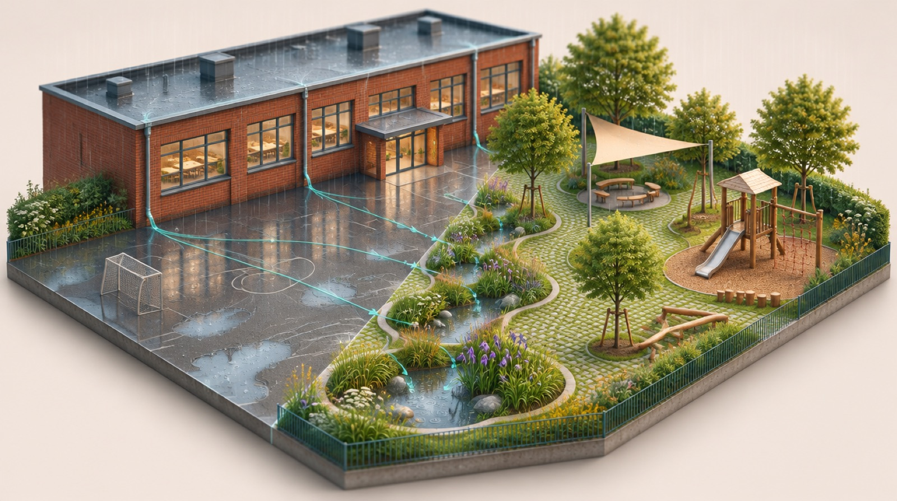

> Pick a real place. Rebuild it from open and official geodata. Let an AI agent redesign it with
> rain gardens, permeable surfaces and shade, and show what each change does to the water and the
> heat, with every number traceable to its source.

This page is the visual tour: eight diagrams, each with what you need to read it. The full
reference, with every rule and number, is [architecture.md](architecture.md).

**Contents**

1. [System context](#1-system-context): who talks to whom
2. [Inside the application](#2-inside-the-application): the building blocks
3. [Starting a plan](#3-starting-a-plan): from a place name to a 3D site
4. [The import pipeline](#4-the-import-pipeline): six steps, each replaceable
5. [Lifecycles](#5-lifecycles): the two state machines
6. [One chat turn](#6-one-chat-turn): the agent designs through tools
7. [Placing an intervention](#7-placing-an-intervention): the LLM chooses, the server does geometry
8. [Where state lives](#8-where-state-lives): one plan id, several stores
9. [From values to pixels](#9-from-values-to-pixels): the configurator engine

**Three ideas run through all of it:**

| Idea | What it means in the code |
|---|---|
| **Everything is a plan id** | The browser, the agent's tools and the workers run in separate processes and requests. They share nothing but the stores, keyed by the plan's id. |
| **The agent designs, the server decides** | The model chooses *what* goes *where*. Geometry, planning rules, clamping and every number come from PHP, so nothing an agent sends can break a scene or invent a figure. |
| **Every number has a basis** | The impact report, the placement candidates and the simulations carry their assumptions and sources, and the UI shows them. |

---

## 1. System context

The application is one Symfony app plus two Messenger workers. It reaches out to map services,
Hamburg's open data portal, the Anthropic API and, for building simulations, Docker.

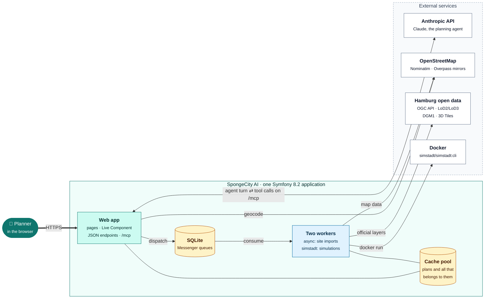

- **The agent's tools are this app's own MCP server.** Claude calls `/mcp` on the same app over
  HTTP while the chat request is still running, so the web server needs more than one worker
  process (the Symfony CLI has several).
- **Slow work never blocks a page.** Site imports (seconds to a minute) and SimStadt runs (up to a
  few minutes) have a queue and a worker each, so one never waits for the other.
- **Every external source can fail on its own.** Overpass is tried mirror by mirror, and each
  Hamburg layer falls back to OpenStreetMap separately. Missing surroundings just mean a generic
  city around the site.

## 2. Inside the application

`src/` is the application; `lib/Core/Configurator/` is the framework-light parametric 3D engine it
builds on. Each layer only calls the layers below it.

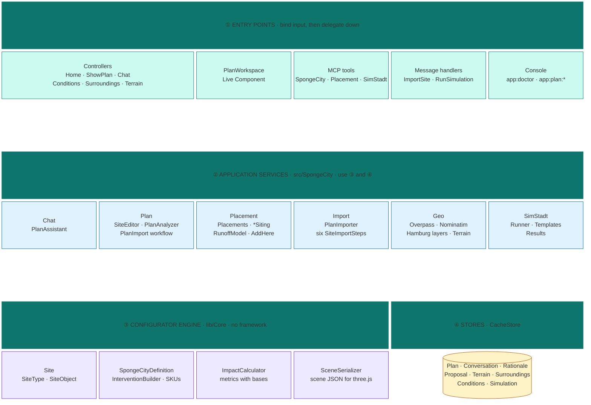

The one loop back up: during a chat turn, `PlanAssistant` sends the conversation to Claude, and
Claude calls the **MCP tools** (an entry point) over HTTP before it answers.

| Layer | Rule of thumb |
|---|---|
| **Entry points** stay thin | Controllers bind input (`#[MapRequestPayload]`, `PlanValueResolver` for `Plan $plan`) and delegate. MCP tools are plain services with `#[McpTool]`. |
| **`SiteEditor` is the only writer of a site** | Every change goes through `SiteType::normalize()`: defaults filled in, numbers clamped, unknown fields dropped, objects kept within 100 m. |
| **Extension points are tagged services** | A new import step, map layer, intervention type or SimStadt workflow is one class with `#[AsTaggedItem]`; nothing else changes. |
| **The engine knows no Symfony** | `lib/Core` has no Doctrine and no HTTP; it turns configuration values into parts, prices, metrics and a scene. |

## 3. Starting a plan

A place name becomes a plan in a few hundred milliseconds. The site arrives later, from a worker,
while the plan page polls its status.

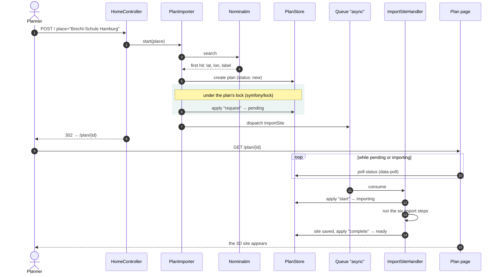

If nothing is found, the controller redirects back home with a flash message. If an import step
throws, the plan moves to `failed` and the page offers a way back. A failed plan can simply be
requested again.

## 4. The import pipeline

  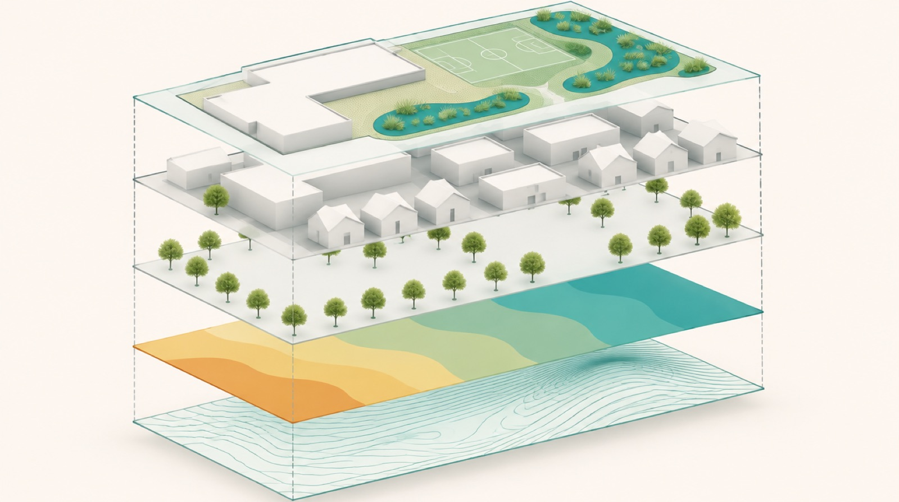
   What the import stacks into one site: terrain, infiltration potential, trees, buildings, and the plot the agent designs on.

`ImportSiteHandler` runs every `SiteImportStep` in priority order, passing one `SiteImportContext`
along. Steps are discovered by `#[AutowireIterator]`, so adding one is a single class.

```mermaid
flowchart LR
    start(["ImportSite<br/>message"]) --> osm
    osm["<b>60 · FetchOpenStreetMap</b><br/><small>Overpass: the ways the point lies in,<br/>buildings, streets, trees</small>"]
    official["<b>50 · ApplyOfficialLayers</b><br/><small>every MapLayer that covers the area:<br/>Hamburg's buildings and street trees</small>"]
    build["<b>40 · BuildSite</b><br/><small>project to plan mm, choose the plot,<br/>classify buildings (BuildingTags)</small>"]
    terrain["<b>30 · ImportTerrain</b><br/><small>DGM1 by HTTP range requests,<br/>2 m and 4 m height grids</small>"]
    cond["<b>20 · CollectSiteConditions</b><br/><small>infiltration potential,<br/>data sources and licences</small>"]
    ground["<b>10 · GroundSite</b><br/><small>stand every upright object<br/>on the terrain</small>"]
    done(["complete → ready<br/><small>then ImportSurroundings</small>"])

    osm --> official --> build --> terrain --> cond --> ground --> done

    classDef step fill:#e0f2fe,stroke:#0369a1,color:#082f49
    classDef hh fill:#ccfbf1,stroke:#0f766e,color:#042f2e
    classDef edge fill:#0f766e,stroke:#0f766e,color:#ffffff
    class osm,build,ground step
    class official,terrain,cond hh
    class start,done edge
```

Teal steps use Hamburg's official data and do nothing outside Hamburg; blue steps run everywhere.

- **One vocabulary for all sources.** Hamburg's datasets are translated into Overpass-like
  elements with OpenStreetMap tags (`building=school`, `height`, `roof:shape`, `diameter_crown`),
  so `SiteImporter` and `BuildingTags` never know where a building came from.
- **The plot** is the most specific polygon the point lies in (leisure, then amenity, then landuse,
  the smaller one winning), or a 40 m square.
- **Surroundings** (the real city out to 350 m) are imported by an `#[AsCompletedListener]` once
  the site is in place. If they fail, the plan does not.

## 5. Lifecycles

Both long-running jobs are Symfony Workflow state machines declared in their own class
(`#[AsWorkflow]`, one `#[Transition]` per constant). An `#[AsEnteredListener]` saves the subject
in every state it enters, which is what the page and the agent poll.

<table>
<tr>
<th>Plan import · <code>PlanImport</code></th>
<th>Building simulation · <code>SimulationRun</code></th>
</tr>
<tr>
<td>

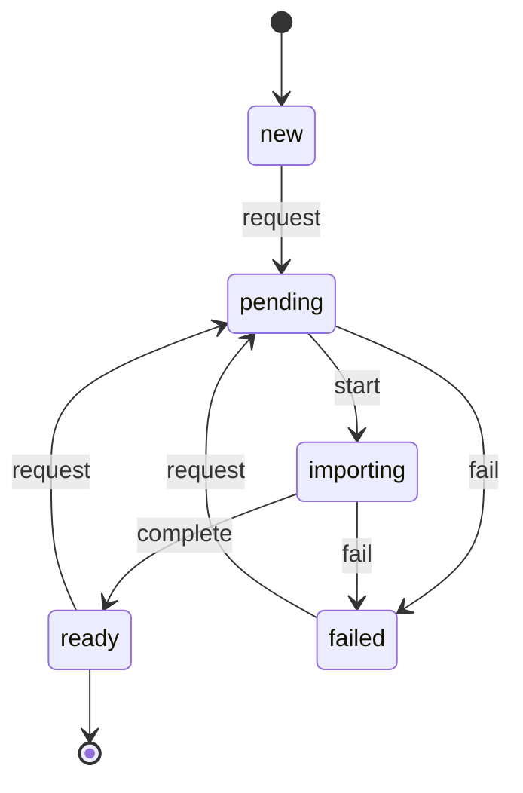

</td>
<td>

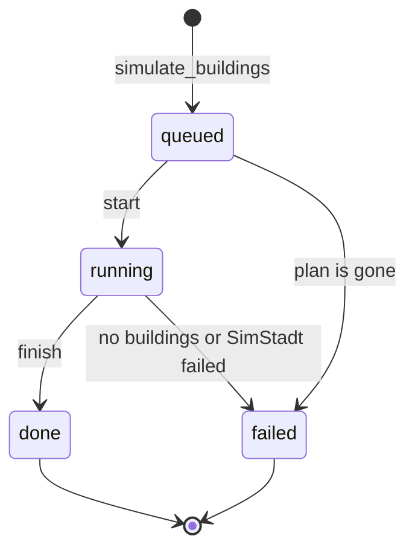

</td>
</tr>
</table>

**Why a lock as well as a state machine?** The cache pool has no compare-and-set. `request` and
`start` read the subject again and apply the transition under a per-subject lock
(`symfony/lock`), so two clicks queue a plan once and two workers never import it twice. The lock
is released before dispatching, because a synchronous dispatch (the console's re-import) runs the
handler in the same process.

## 6. One chat turn

  
   The person and the agent edit the same plan. The agent works only through tools, and the server snaps what it places to the rules.

A turn is several model calls with tool calls in between, 40 to 60 seconds when the agent places
interventions. The user watches the design appear because the page re-renders while the agent
works.

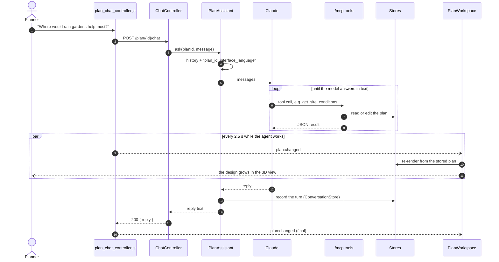

**The agent's toolbox** (all on `/mcp`, exposed to the model with the prefix `local_`):

| Look | Design | Measure | Place by rules | Buildings |
|---|---|---|---|---|
| `get_site` `get_site_conditions` `list_object_types` `search_place` · `load_site` | `add_objects` `update_object` `remove_object` `clear_interventions` | `calculate_impact` `set_design_storm` | `propose_placements` `place_candidate` `get_zones` · `describe_zone` | `simulate_buildings` `get_building_simulation` |

The tools are stateless: the plan id travels with every message. The system prompt
(`config/prompts/spongecity.md`) tells the agent to look first, design with tools, measure before
it claims anything, and never state a number that did not come from a tool.

## 7. Placing an intervention

  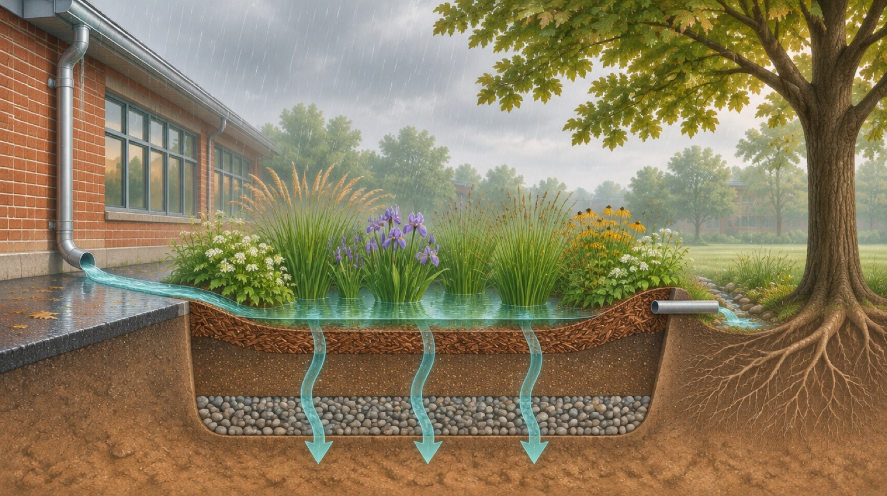
   What <code>RainGardenSiting</code> sizes: a basin that takes the runoff of the sealed ground upstream, stores it and lets it soak away, kept clear of walls and root zones.

A language model is good at deciding that "a rain garden at the low end of the yard" makes sense
and bad at keeping its corners off a wall. So the work is split.

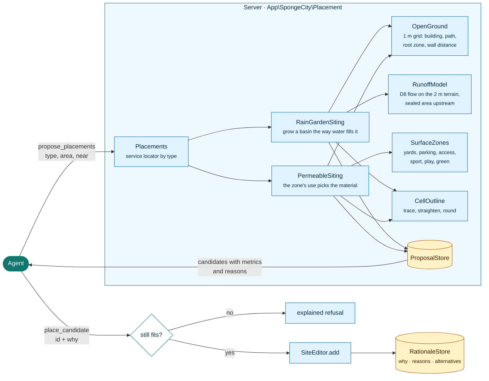

Every placed object keeps a **rationale**: the agent's words, the candidate's reasons and numbers,
and the alternatives it was chosen over. The 3D view floats a badge over it, and a person can
preview any alternative and swap it in. The same rules serve the 3D view's "add here" menu
(`AddHere`), so a person and the agent place things the same way.

## 8. Where state lives

There are no database entities. Everything about a plan lives in the application cache pool,
each kind of object under its own key prefix and the plan's id. The SQLite database holds only
the Messenger queues.

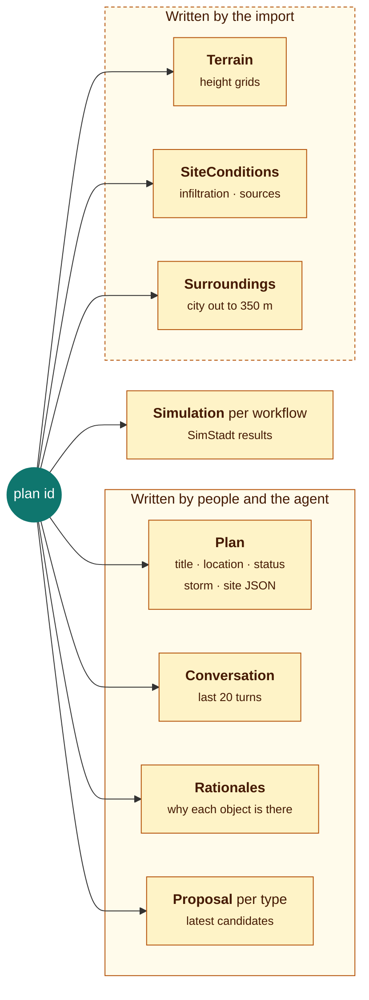

| Store | Key | Read by |
|---|---|---|
| `PlanStore` | `spongecity_plan_{id}` | everything |
| `ConversationStore` | `spongecity_conversation_{id}` | chat, plan page |
| `RationaleStore` | `spongecity_rationales_{id}` | workspace, placement tools |
| `ProposalStore` | `spongecity_proposal_{id}_{type}` | `place_candidate` |
| `TerrainStore` | `spongecity_terrain_{id}` | 3D view, site editor, agent |
| `SiteConditionsStore` | `spongecity_conditions_{id}` | 3D view overlay, agent |
| `SurroundingsStore` | `spongecity_surroundings_{id}` | 3D view |
| `SimulationStore` | `spongecity_simstadt_{id}_{workflow}` | agent |

All of them extend `CacheStore`, which is fine for a demo and not for production: swapping
`PlanStore` and its siblings for a database implementation is the main step towards running this
for real.

## 9. From values to pixels

A plan is a handful of configuration values (`storm`, `site`). The engine turns them into a
priced product, a measured impact and a scene the browser draws.

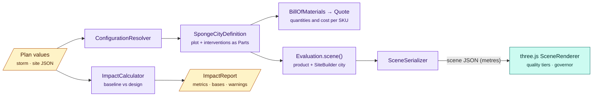

- **Units:** millimetres on the server, metres in the browser. Plan coordinates run x east and
  z south, from the searched point.
- **Interventions are the product:** they carry SKUs, so they are priced, listed in the bill of
  quantities, framed by the camera and named on hover. The real city around them is scenery.
- **The impact is a planning-level estimate, not a simulation:** the plot is rasterised, each cell
  takes its top-most surface, and runoff coefficients follow DWA-A 138 and DIN 1986-100. Every
  metric states its basis.

---

Illustrations are concept art (generated with Higgsfield) and show the idea, not the app's screens. Diagrams are [Mermaid](https://mermaid.js.org/), rendered by GitHub and most editors. Edit them as text; keep the colour classes (teal: entry points and people, blue: services, violet: engine, amber: data) so the pages read as one set.
